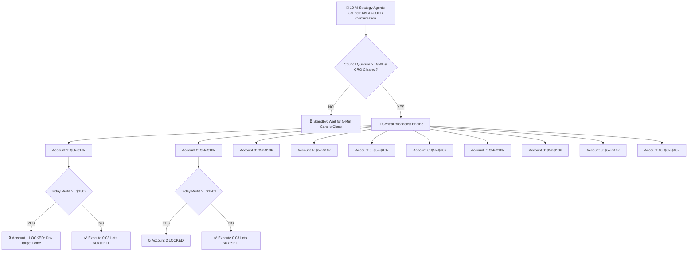

# 🏛️ Multi-Account AI Trading Architecture (10 Accounts Blueprint)
### Dedicated Pure Gold (XAUUSD) • Multi-Terminal Python Direct API • $150 Daily Target Lock

> **Status**: Architectural Blueprint / Reference Guide (Ready for future activation when needed).  
> **Target Symbol**: `XAUUSD` (Gold)  
> **Account Sizing**: $5,000 – $10,000 Equity per account (Total Portfolio: $50,000 – $100,000)  
> **Daily Goal**: **$150 USD Profit per Account** (~1.5% – 3.0% daily return), with automatic shutdown upon reaching target.

---

## 📌 Executive Summary

This architecture enables the **10 AI Strategy Agents Council** to perform market analysis **once** on Gold (`XAUUSD`) and simultaneously broadcast verified institutional orders across **10 MetaTrader 5 accounts**.

- **Zero Chart EAs Required**: Operates 100% via the native Python `MetaTrader5` API directly in memory.
- **Simultaneous Execution**: All 10 accounts execute within < 50 milliseconds during key London / New York liquidity moves.
- **Independent $150 Daily Profit Lock**: Each account automatically locks and halts trading for the day once it achieves +$150 net closed profit.

---

## 🔄 How the Execution Flow Works



---

## 🛡️ Key Features & Safeguards

### 1. Independent $150 Daily Profit Lock
- **Calculation**: Tracks closed deal profits starting from `00:00 MT5 Server Time` each day.
- **Trigger**: Once `Daily Closed Profit >= $150.00`, the account transitions to state `TARGET_ACHIEVED_LOCKED`.
- **Protection**: Zero new orders are allowed on locked accounts until the daily midnight reset.
- **Other Accounts**: Unaffected accounts continue operating until their respective $150 target is booked.

### 2. Micro-Risk Dynamic Lot Sizing
- On $5,000 – $10,000 equity:
  - **Base Volume**: `0.02 – 0.04 Lots` per trade.
  - **Stop Loss**: $7.50 – $9.50 on Gold (~$25 – $35 risk = **0.35% – 0.5% risk per trade**).
  - **Take Profit 1 (1:2 RR)**: +$15.00 move on Gold = **+$60 to +$90 profit per trade**.
  - **Target Achievement**: Usually achieved in **1 to 2 clean trend continuation trades** per account.

### 3. Simultaneous vs Sequential Trading
- **Why Simultaneous is Essential**: High-impact Gold institutional orderflow moves (London Open 1:30 PM IST, NY Open 6:30 PM IST) happen in fast 15–30 minute windows. Simultaneous execution guarantees all 10 accounts catch the same A+ setup.

---

## ⚙️ Configuration Template (For Future Reference)

When ready to enable multi-account trading, the configuration in `config.py` is structured as follows:

```python
# Multi-Account Deployment Configuration
MULTI_ACCOUNT_MODE = True
DAILY_PROFIT_TARGET_USD = 150.0   # $150 daily target per account
MAX_DAILY_LOSS_PER_ACC_USD = 150.0 # Strict 1:1 daily loss limit ($150 max drawdown)

ACCOUNTS_CONFIG = [
    {"id": "ACC_01", "login": 100101, "password": "xxx", "server": "Broker-Live", "target": 150.0, "max_lots": 0.05},
    {"id": "ACC_02", "login": 100102, "password": "xxx", "server": "Broker-Live", "target": 150.0, "max_lots": 0.05},
    {"id": "ACC_03", "login": 100103, "password": "xxx", "server": "Broker-Live", "target": 150.0, "max_lots": 0.05},
    {"id": "ACC_04", "login": 100104, "password": "xxx", "server": "Broker-Live", "target": 150.0, "max_lots": 0.05},
    {"id": "ACC_05", "login": 100105, "password": "xxx", "server": "Broker-Live", "target": 150.0, "max_lots": 0.05},
    {"id": "ACC_06", "login": 100106, "password": "xxx", "server": "Broker-Live", "target": 150.0, "max_lots": 0.05},
    {"id": "ACC_07", "login": 100107, "password": "xxx", "server": "Broker-Live", "target": 150.0, "max_lots": 0.05},
    {"id": "ACC_08", "login": 100108, "password": "xxx", "server": "Broker-Live", "target": 150.0, "max_lots": 0.05},
    {"id": "ACC_09", "login": 100109, "password": "xxx", "server": "Broker-Live", "target": 150.0, "max_lots": 0.05},
    {"id": "ACC_10", "login": 100110, "password": "xxx", "server": "Broker-Live", "target": 150.0, "max_lots": 0.05},
]
```

---

## 🖥️ System & Hardware Specifications

| Component | Minimum Specification | Recommended Specification |
| :--- | :--- | :--- |
| **Operating System** | Windows 10 / 11 / Windows Server 2022 | Windows 11 Pro / Server 2022 |
| **CPU** | 4 Cores (Intel i5 / AMD Ryzen 5 / 4 vCPU) | 8 Cores (Intel i7 / Ryzen 7 / 8 vCPU) |
| **RAM** | 8 GB RAM | 16 GB RAM |
| **Network Latency** | < 100 ms to broker | < 20 ms (London / NY VPS) |
| **MT5 Setup** | 10 Portable Terminal Folders | 10 Portable Terminal Folders |

---

## 📊 Summary Table

| Metric | Single Account | 10 Accounts Combined |
| :--- | :--- | :--- |
| **Daily Target** | $150 / day | **$1,500 / day** |
| **Monthly Potential (20 Days)** | $3,000 / month | **$30,000 / month** |
| **Portfolio Drawdown Protection** | Hard stop at -$150 | Hard stop at -$150 per account |
| **Strategy Source** | 10 AI Agents Council | 10 AI Agents Council (Unified) |
| **Chart EA Requirement** | **None (0 EA)** | **None (0 EA)** |
