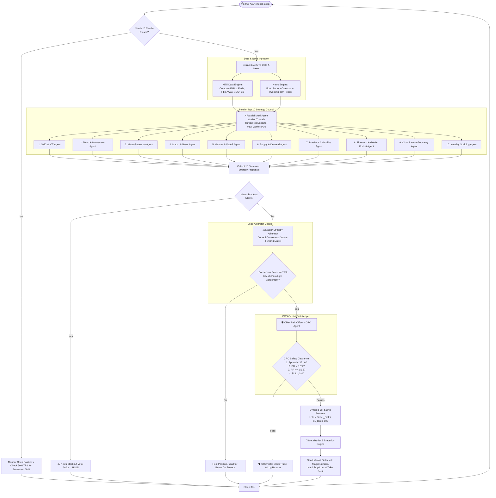
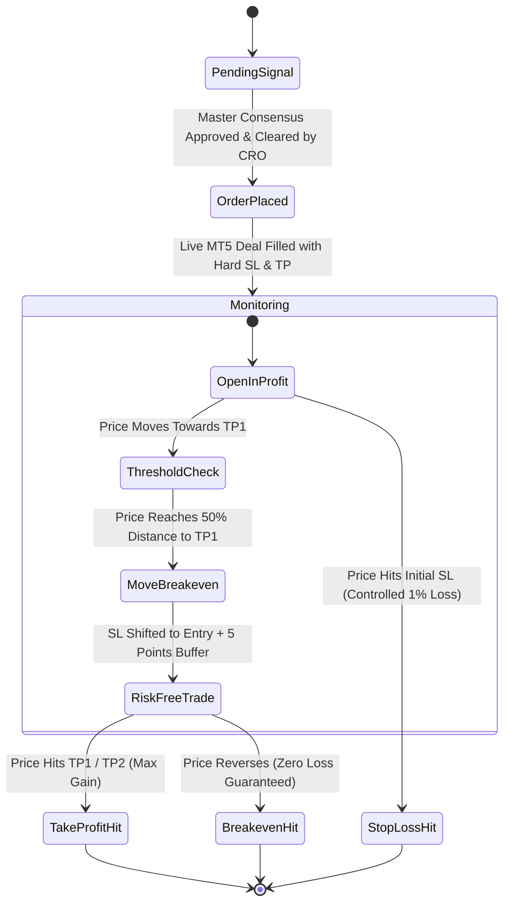

# 🏛️ Complete Architecture & Decision Flow Diagrams

This document contains the complete visual flowcharts, sequence diagrams, and mathematical pipelines for the **Claude Top 10 Strategy Agents AI Trading Council (XAUUSD Gold)**.

> [!TIP]
> You can also view the interactive visual dashboard version by opening **[flow_diagram.html](file:///d:/Ai%20Trading%20ALGO/flow_diagram.html)** in your browser!

---

## 1. Complete End-to-End 24/5 System Lifecycle Flowchart



---

## 2. 10-Agent Voting Matrix & Consensus Flow

```mermaid
flowchart LR
    subgraph Strategy Inputs
        A1[1. SMC / ICT] -->|BUY 85%| Matrix
        A2[2. Trend Momentum] -->|BUY 80%| Matrix
        A3[3. Mean Reversion] -->|HOLD 20%| Matrix
        A4[4. Macro News] -->|BULLISH +65%| Matrix
        A5[5. Volume / VWAP] -->|BUY 82%| Matrix
        A6[6. Supply / Demand] -->|BUY 80%| Matrix
        A7[7. Breakout Squeeze] -->|HOLD 40%| Matrix
        A8[8. Fibonacci OTE] -->|BUY 88%| Matrix
        A9[9. Chart Patterns] -->|BUY 75%| Matrix
        A10[10. Scalping Fast] -->|BUY 85%| Matrix
    end

    subgraph Council Arbitration Engine
        Matrix[10-Agent Voting Matrix\nBUY: 7 | HOLD: 3 | SELL: 0] --> WeightEngine[Confluence Synthesizer:\nSMC + Fibonacci 0.618 + VWAP + Trend]
        WeightEngine --> ConflictResolver{Strategic Conflict\nDetected?}
        ConflictResolver -- No Conflict --> ScoreCalc[Consensus Score: 88%\nAgreement: UNANIMOUS SUPERMAJORITY]
        ConflictResolver -- Conflict Present --> Resolution[Arbitrate Conflict:\nFavor Trend / Structural Invalidation] --> ScoreCalc
    end

    subgraph Final Action
        ScoreCalc --> Ruling[Master Ruling: BUY\nEntry: 2724.50 | SL: 2719.50 | TP1: 2734.50]
    end
```

---

## 3. Chief Risk Officer (CRO) Dynamic Lot Sizing Flow

```mermaid
flowchart TD
    Input[Consensus Trade Proposal: BUY @ 2724.50 | SL: 2719.50] --> Equity[Get Live Account Equity\ne.g. $50,000]
    
    Equity --> RiskUSD[Calculate Target Risk Amount:\nRisk USD = $50,000 x 1.0% = $500.00]
    
    Input --> SL_Dist[Calculate Price Distance to SL:\nSL Distance = 2724.50 - 2719.50 = $5.00]
    
    RiskUSD & SL_Dist --> Formula[Mathematical Lot Sizing Formula:\nLots = Risk_USD / SL_Distance x Contract_Size_100\nLots = $500 / $5.00 x 100 = 1.00 Lot]
    
    Formula --> StepRounding[Step Rounding & Min/Max Constraints:\nVolume Step: 0.01 | Min: 0.01 | Max: 100.0]
    
    StepRounding --> ClearedLots[Final Cleared Volume: 1.00 Standard Lot]
```

---

## 4. Active Trade Life-Cycle & Breakeven Trailing


