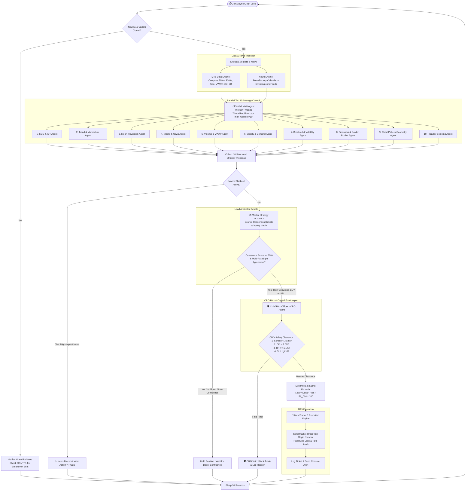
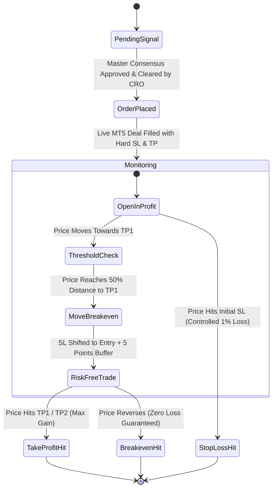

# 🧠 How the Multi-Agent Trading Council Works & 1-Month 24/5 API Cost Analysis

This document provides a comprehensive technical breakdown of the **Top 10 Strategy Agents Council**, detailed **Architecture & Decision Flow Diagrams**, and an exact **Token & API Cost Breakdown** for running the bot 24 hours a day for one full month.

---

## 📊 Complete Visual Flow Diagrams

### Diagram 1: 24/5 End-to-End Autonomous Trading Lifecycle



---

### Diagram 2: Multi-Agent Consensus & Voting Matrix Flow

```mermaid
flowchart LR
    subgraph Strategy Inputs
        A1[1. SMC / ICT] -->|BUY 85%| Matrix
        A2[2. Trend Momentum] -->|BUY 80%| Matrix
        A3[3. Mean Reversion] -->|HOLD 20%| Matrix
        A4[4. Macro News] -->|BULLISH +65%| Matrix
        A5[5. Volume / VWAP] -->|BUY 82%| Matrix
        A6[6. Supply / Demand] -->|BUY 80%| Matrix
        A7[7. Breakout Squeeze] -->|HOLD 40%| Matrix
        A8[8. Fibonacci OTE] -->|BUY 88%| Matrix
        A9[9. Chart Patterns] -->|BUY 75%| Matrix
        A10[10. Scalping Fast] -->|BUY 85%| Matrix
    end

    subgraph Council Arbitration Engine
        Matrix[10-Agent Voting Matrix\nBUY: 7 | HOLD: 3 | SELL: 0] --> WeightEngine[Confluence Synthesizer:\nSMC + Fibonacci 0.618 + VWAP + Trend]
        WeightEngine --> ConflictResolver{Strategic Conflict\nDetected?}
        ConflictResolver -- No Conflict --> ScoreCalc[Consensus Score: 88%\nAgreement: UNANIMOUS SUPERMAJORITY]
        ConflictResolver -- Conflict Present --> Resolution[Arbitrate Conflict:\nFavor Trend / Structural Invalidation] --> ScoreCalc
    end

    subgraph Final Action
        ScoreCalc --> Ruling[Master Ruling: BUY\nEntry: 2724.50 | SL: 2719.50 | TP1: 2734.50]
    end
```

---

### Diagram 3: Chief Risk Officer (CRO) Dynamic Lot Sizing Flow

```mermaid
flowchart TD
    Input[Consensus Trade Proposal: BUY @ 2724.50 | SL: 2719.50] --> Equity[Get Live Account Equity\ne.g. $50,000]
    
    Equity --> RiskUSD[Calculate Target Risk Amount:\nRisk USD = $50,000 x 1.0% = $500.00]
    
    Input --> SL_Dist[Calculate Price Distance to SL:\nSL Distance = 2724.50 - 2719.50 = $5.00]
    
    RiskUSD & SL_Dist --> Formula[Mathematical Lot Sizing Formula:\nLots = Risk_USD / SL_Distance x Contract_Size_100\nLots = $500 / $5.00 x 100 = 1.00 Lot]
    
    Formula --> StepRounding[Step Rounding & Min/Max Constraints:\nVolume Step: 0.01 | Min: 0.01 | Max: 100.0]
    
    StepRounding --> ClearedLots[Final Cleared Volume: 1.00 Standard Lot]
```

---

### Diagram 4: Active Trade Life-Cycle & Breakeven Trailing



---

## 🏛️ Part 2: Step-by-Step Decision Pipeline Explanation

### 1. Ingestion & Indicator Extraction (Every Candle Close)
- On every **M15 candle close**, the `MT5DataEngine` extracts OHLCV data across M5, M15, H1, and H4 timeframes.
- It computes mathematical features:
  - **EMAs** (9, 21, 50, 200), **ATR(14)**, **RSI(14)**, **Bollinger Bands & Squeeze width**.
  - **Fair Value Gaps (FVGs)** and Asian session highs/lows.
  - **Fibonacci Retracements** (0.50, 0.618 Golden Pocket, 0.786 OTE) & Extensions (1.272, 1.618).
  - **Fresh Supply & Demand Imbalance bases** (RBR / DBD).
  - **Intraday VWAP** and Candlestick patterns (Pinbars, Engulfing).
- Simultaneously, `ForexNewsEngine` checks **ForexFactory.com** for upcoming high-impact USD events and **Investing.com** for real-time market sentiment.

### 2. Parallel Strategy Council Deliberation
- Using a Python `ThreadPoolExecutor(max_workers=10)`, all 10 specialized agents analyze the market **simultaneously in parallel** (deliberation completes in ~2 seconds).
- Each agent returns a structured **Tool Call** containing:
  - `action`: `BUY`, `SELL`, or `HOLD`
  - `confidence_score`: 0 to 100%
  - `bias`: `BULLISH`, `BEARISH`, or `NEUTRAL`
  - `setup_name`: Specific institutional setup name
  - `entry_price`, `stop_loss`, `take_profit_1`, `take_profit_2`
  - `reasoning`: Chain-of-thought strategy rationale

### 3. Master Arbitrator Synthesis & Council Debate
- The **Lead Arbitrator** (`master_coordinator.py`) reviews all 10 proposals:
  - **Voting Matrix**: Tabulates the vote distribution (e.g. `BUY: 7, SELL: 0, HOLD: 3`).
  - **Quorum Consensus Check**: Requires a consensus score of **>= 75%** and multi-paradigm agreement (e.g., SMC + Fibonacci + Trend + VWAP all agreeing).
  - **Conflict Resolution**: If Trend says BUY but Mean-Reversion warns of extreme overbought RSI exhaustion at resistance, the Arbitrator either waits for a pullback or issues `HOLD`.
  - **Macro Blackout Shield**: If a high-impact USD red-folder event is within +/- 15 minutes, the trade is automatically blocked.

### 4. Chief Risk Officer (CRO) Dynamic Lot Sizing
- The **CRO Agent** (`risk_agent.py`) evaluates the approved proposal before any order touches the broker:
  - **Dynamic Lot Sizing Formula**:
    $$\text{Dollar Risk} = \text{Account Equity} \times \left(\frac{\text{Risk \%}}{100}\right)$$
    $$\text{Calculated Lots} = \frac{\text{Dollar Risk}}{\text{SL Distance} \times \text{Contract Size (100)}}$$
    *Example*: On a **$50,000** account with **1.0% risk** ($500) and a **$5.00 SL distance** on Gold:
    $$\text{Lots} = \frac{\$500}{\$5.00 \times 100} = \mathbf{1.00\text{ standard lot}}$$
  - **Safety Filters**: Enforces minimum **1:1.5+ Risk-to-Reward**, maximum daily drawdown ceiling (e.g., 3.0%), and spread limits.

### 5. MT5 Execution & Position Management
- Submits the order to MetaTrader 5 with magic number, comments, and hard SL/TP on the broker's server.
- Automatically shifts the Stop Loss to **Breakeven** once price reaches 50% of the distance to TP1 (risk-free trade).

---

## 💰 Part 3: 1-Month 24/5 Running Cost (Anthropic API Breakdown)

Forex/Gold markets trade **24 hours a day, 5 days a week** (~22 trading days / 528 hours per month).

### 1. Token Metrics Per Deliberation (10 Agents + Master Coordinator)

| Component | Input Tokens | Output Tokens |
| :--- | :--- | :--- |
| **10 Strategy Agents (Parallel)** | 10 × 600 = ~6,000 tokens | 10 × 150 = ~1,500 tokens |
| **Master Arbitrator Coordinator** | ~2,000 tokens | ~350 tokens |
| **Total Per Candle Deliberation** | **~8,000 Input Tokens** | **~1,850 Output Tokens** |

---

### 2. Anthropic API Pricing (Standard Claude 3.7 / 3.5 Sonnet)

- **Input Tokens**: $3.00 per 1,000,000 tokens ($0.003 / 1k tokens)
- **Output Tokens**: $15.00 per 1,000,000 tokens ($0.015 / 1k tokens)
- **Prompt Caching (Enabled by default)**: 90% discount on cached input prompts ($0.30 / 1M tokens).

---

### 3. Monthly Cost Estimates (24 Hours / 5 Days a Week)

#### 🔹 Scenario A: M15 Timeframe (Every 15-Minute Candle Close)
- Deliberation frequency: 4 times/hour × 24 hours × 22 days = **2,112 deliberations / month**.
- **Monthly Token Volume**:
  - Input: $2,112 \times 8,000 = 16.89\text{ Million tokens}$
  - Output: $2,112 \times 1,850 = 3.91\text{ Million tokens}$
- **Monthly Cost**:
  - *Without Caching*: $(16.89 \times \$3.00) + (3.91 \times \$15.00) = \$50.69 + \$58.65 = \mathbf{\$109.34\text{ / month}}$
  - *With Prompt Caching*: $(16.89 \times \$0.75\text{ avg}) + (3.91 \times \$15.00) = \mathbf{\approx \$71.30\text{ / month}}$

---

#### 🔹 Scenario B: H1 Timeframe (Every 1-Hour Candle Close - Recommended for Swing/Trend)
- Deliberation frequency: 1 time/hour × 24 hours × 22 days = **528 deliberations / month**.
- **Monthly Token Volume**:
  - Input: $528 \times 8,000 = 4.22\text{ Million tokens}$
  - Output: $528 \times 1,850 = 0.98\text{ Million tokens}$
- **Monthly Cost**:
  - Total: $(4.22 \times \$3.00) + (0.98 \times \$15.00) = \$12.66 + \$14.70 = \mathbf{\approx \$27.36\text{ / month}}$

---

#### 🔹 Scenario C: Hybrid High-Performance Mode (Haiku for 10 Agents + Sonnet for Master Arbitrator)
- **10 Strategy Agents** powered by **Claude 3.5 Haiku** ($0.80/M input, $4.00/M output).
- **Master Arbitrator** powered by **Claude 3.7 Sonnet** ($3.00/M input, $15.00/M output).
- **Monthly Cost on M15**: **$\approx \$46.50\text{ / month}$**.

---

### 📊 Summary Cost Table

| Setup | Execution Cadence | Claude Model | Approx. 1-Month Cost (24/5) |
| :--- | :--- | :--- | :--- |
| **M15 Scalping & Swing** | Every 15 minutes | Claude 3.7 / 3.5 Sonnet | **~$70 – $109 / month** |
| **H1 Trend & Institutional** | Every 1 hour | Claude 3.7 / 3.5 Sonnet | **~$27 / month** |
| **M15 Hybrid Optimization** | Every 15 minutes | Haiku (Agents) + Sonnet (Arbitrator)| **~$46 / month** |
